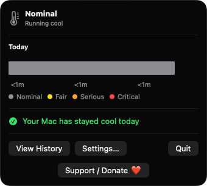
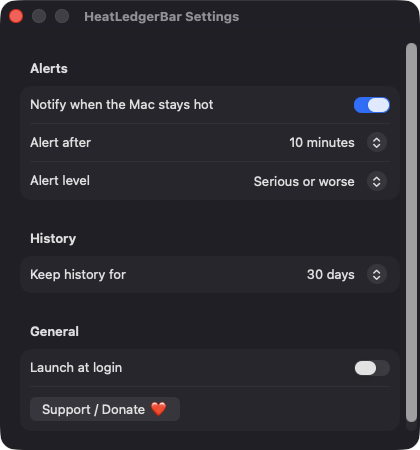
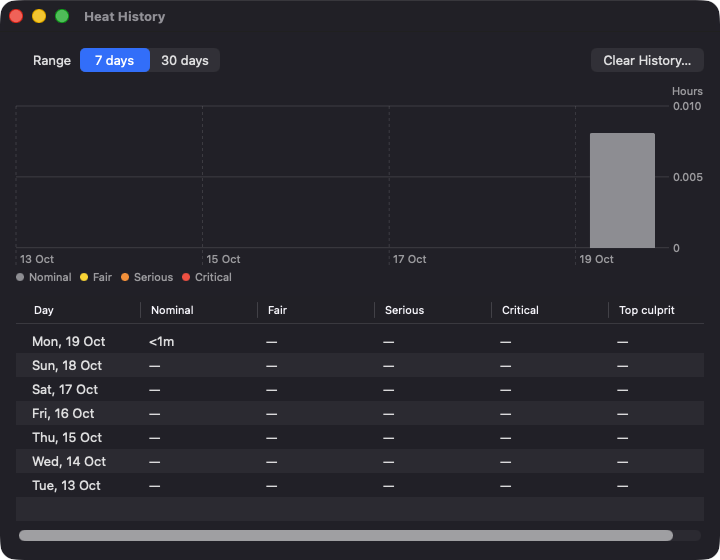

# HeatLedgerBar

**🌐 Website:** [turhe123.github.io/heat-ledger-bar](https://turhe123.github.io/heat-ledger-bar/)

Log how long your Mac spends in each thermal state each day and show which apps were running when it got hot.

> 🆓 A free, open-source **Sensei alternative** for macOS 14+. Native Swift, no accounts, no subscriptions, MIT licensed.


## Why

HeatLedgerBar is a free, open-source, 100% native, backend-free alternative to paid utilities in the *System Monitoring* category. It was inspired by suites such as Sensei ($29/year or $59 one-time), which include a temperature and thermal view of the Mac. HeatLedgerBar takes a different angle: instead of a live temperature readout from private sensors, it keeps a day-by-day record of the official macOS thermal state and shows which apps were around when heat built up. Everything stays on your Mac.

## Features

- **Menu bar thermometer** tinted by the current thermal state: gray (nominal), yellow (fair), orange (serious), red (critical).
- **Thermal ledger**: every change of the system thermal state is recorded with timestamps, using `ProcessInfo.thermalState` and its change notification.
- **Today's stacked bar** (Swift Charts) showing the share of time spent in each state.
- **Recent hot periods**: the last three hot intervals, each with the frontmost app and the heaviest apps by CPU.
- **Culprit detection**: while the Mac is at fair or worse, per-process CPU time is sampled every 10 seconds and the top apps are kept per interval (capped at five).
- **History window** with a 7-day / 30-day chart and a per-day table (time per state and top culprit).
- **Threshold notifications** when the Mac stays hot for 5, 10 or 20 minutes (serious or worse, or critical only), naming the heaviest app. At most one alert per hot period; it re-arms after a return to nominal.
- **Retention** of 7, 14 or 30 days, plus a Clear History action.
- **Sleep/wake aware**: open intervals are closed on sleep and a new one starts on wake. Launching while already hot is marked as *partial*. Negative durations from clock changes are ignored.
- **Launch at login** via `SMAppService`.
- **Local storage only**: history is a JSON file in `~/Library/Application Support/HeatLedgerBar/`. No network, no accounts.
- A **Support / Donate ❤️** button in the popover and in Settings.

## Screenshots

<p align="center"></p>

<p align="center"><em>The menu bar popover shows the current thermal state, today&#x27;s time-in-state bar, and quick links to history, settings and support.</em></p>

<p align="center"></p>

<p align="center"><em>Settings let you choose when hot-Mac alerts fire, how long history is kept, and whether the app launches at login.</em></p>

<p align="center"></p>

<p align="center"><em>The Heat History window charts time per thermal state over 7 or 30 days, with a per-day table and top culprit app.</em></p>

## Install

1. Download `HeatLedgerBar-macOS.zip` from the [latest release](https://github.com/turhe123/heat-ledger-bar/releases/latest).
2. Unzip it and move `HeatLedgerBar.app` to `/Applications`.
3. Because the app is open source and not notarized, clear the quarantine attribute:

   ```bash
   xattr -cr /Applications/HeatLedgerBar.app
   ```

4. Right-click the app and choose **Open** the first time.

## Build from source

Requires macOS 14+ and Xcode with Swift 5.9+.

```bash
brew install xcodegen
xcodegen generate
xcodebuild -project HeatLedgerBar.xcodeproj -scheme HeatLedgerBar -configuration Release -derivedDataPath ./build build
```

The app is produced at `build/Build/Products/Release/HeatLedgerBar.app`.

## Permissions

HeatLedgerBar needs very little:

- **Notifications**: requested at launch (alert and sound) so it can warn you when your Mac stays hot. Optional; the ledger works without it.
- **Login item**: only if you turn on *Launch at login*; macOS may ask you to approve it in System Settings › General › Login Items.

It does **not** request Accessibility, Screen Recording, Microphone, Camera, Location or Full Disk Access. The frontmost app name comes from `NSWorkspace` and CPU usage from per-process counters, neither of which needs a privacy permission. Apps owned by other users may not appear in CPU sampling.

## Built with AI

HeatLedgerBar was written by [Claude Code](https://claude.com/claude-code) inside an automated pipeline, from a plain-English spec. No code, binaries or assets from any commercial app were used; it is a clean-room reimplementation of a feature set, not a copy.

What that means in practice:

- The full source is in this repo under the MIT license. Read it before you run it.
- No network calls, no analytics, no third-party dependencies. Only Apple frameworks.
- Ad-hoc signed and not notarized, which is why Gatekeeper warns on first launch.
- It has had less human review than a hand-written app. Bug reports and pull requests are welcome.

## Support ❤️

HeatLedgerBar is free and always will be. If it's useful to you, you can help keep it going:

[☕ Support Or (Leo) Davidai ❤️ on Ko-fi](https://ko-fi.com/leodavidai)

## More free Mac apps

HeatLedgerBar is one of [60 free, open-source Mac utilities](https://github.com/turhe123/mac-apps) built the same way: native Swift, no accounts, no telemetry. Browse the full gallery at [turhe123.github.io/mac-apps](https://turhe123.github.io/mac-apps/).

## License

MIT © Or Davidai Bachar
